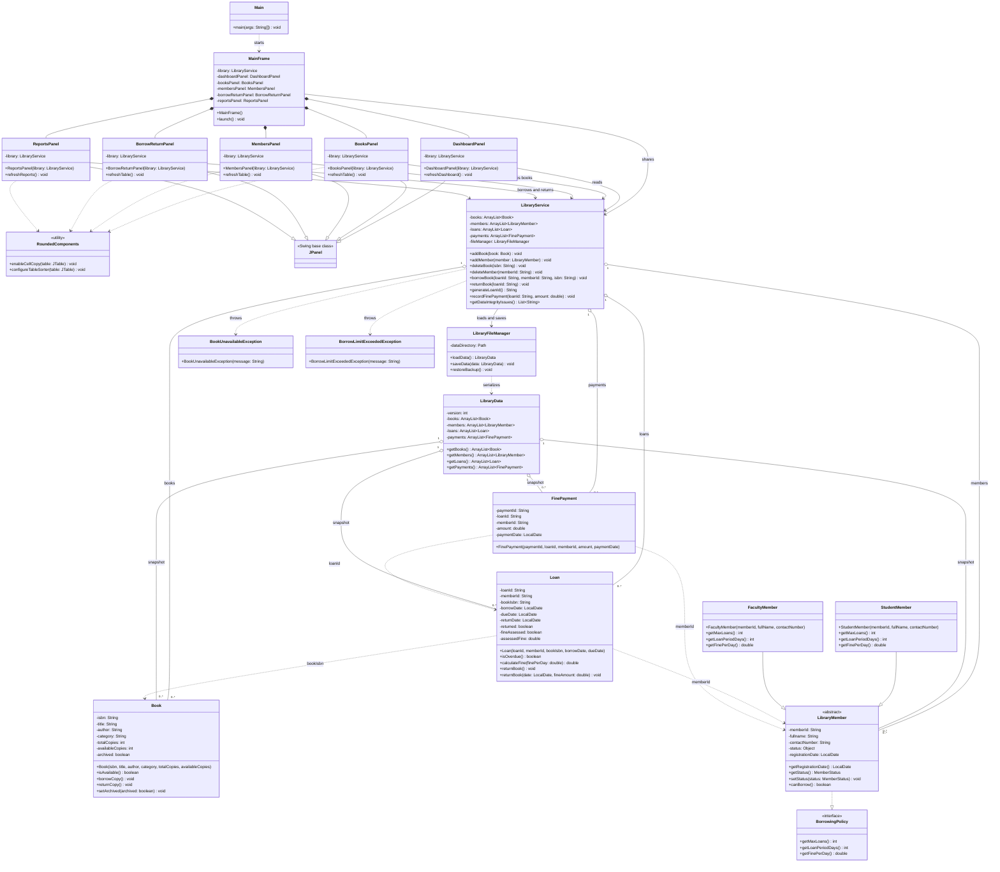

# Libracore UML Class Diagram

This diagram reflects the classes and relationships in `src/`. The GUI panels call `LibraryService`; the service applies library rules and delegates persistence to `LibraryFileManager`. `Loan` and `FinePayment` store ISBNs and IDs as strings, so those links are references in the saved data rather than direct object fields.

`MemberStatus` is a nested enum inside `LibraryMember`. The status field is declared as `Object` to keep older serialized values readable, then converted back to `MemberStatus` by `getStatus()`. `MainFrame.launch()` is static. The diagram omits private UI widgets and helper methods to keep the design readable; it shows the main model, service, persistence, and screen relationships.
